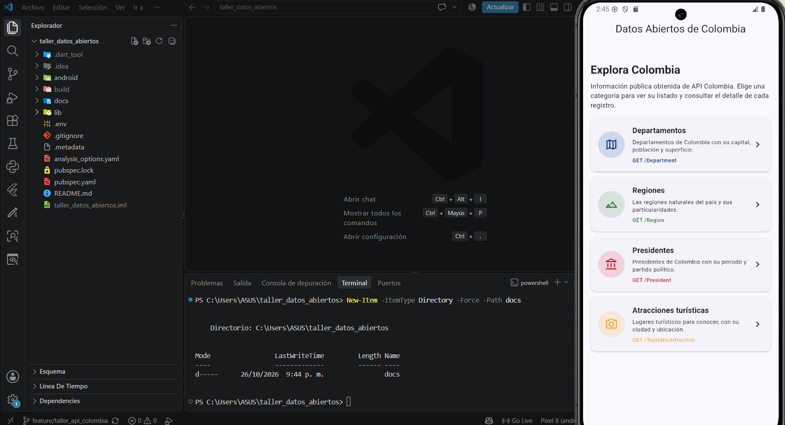
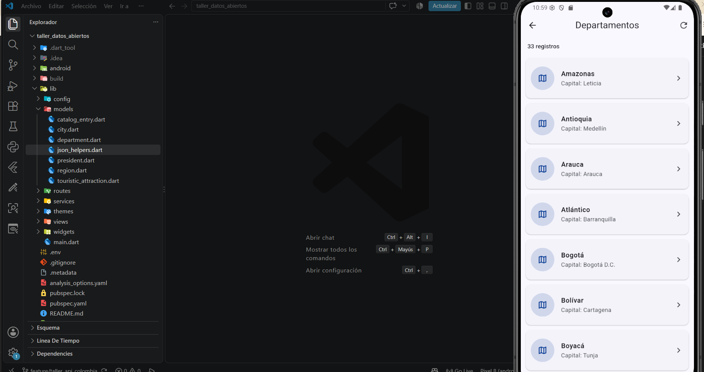
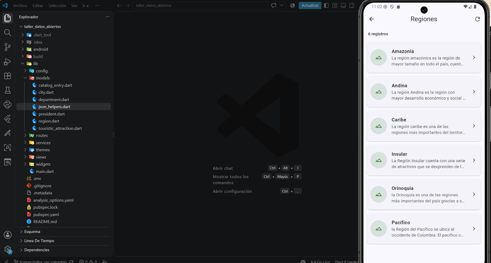
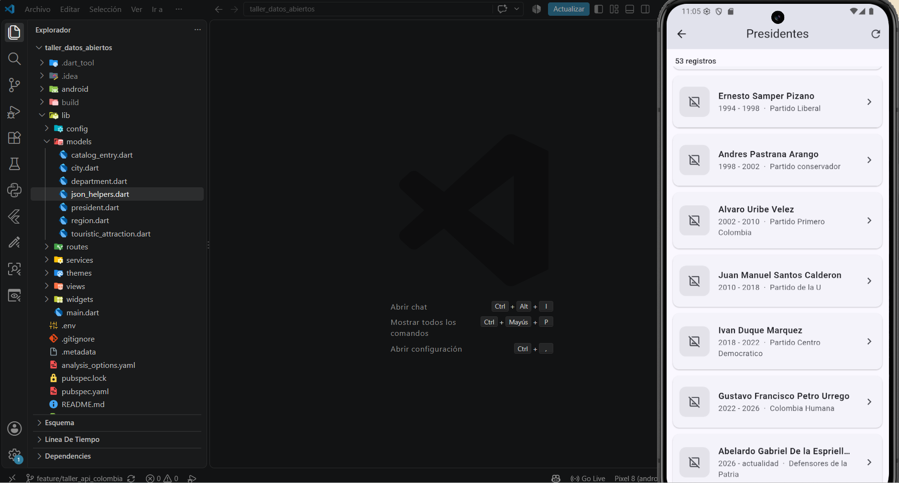
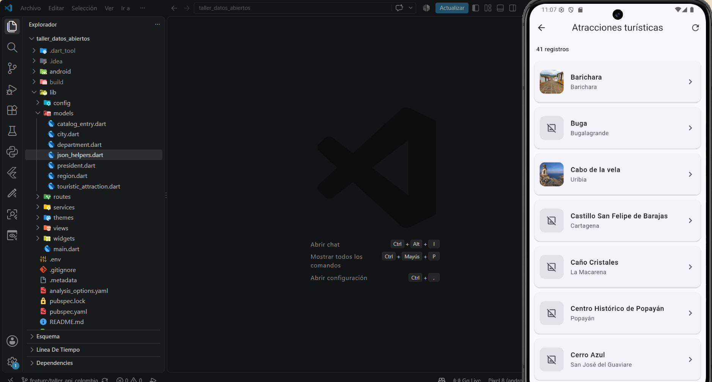
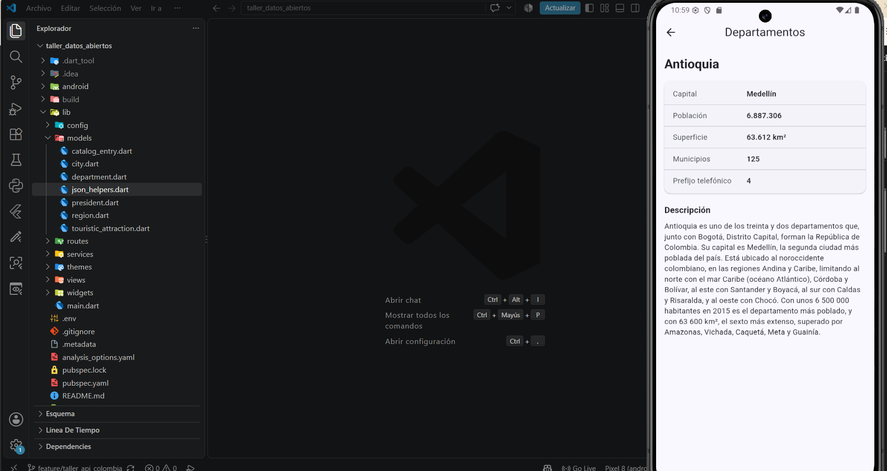
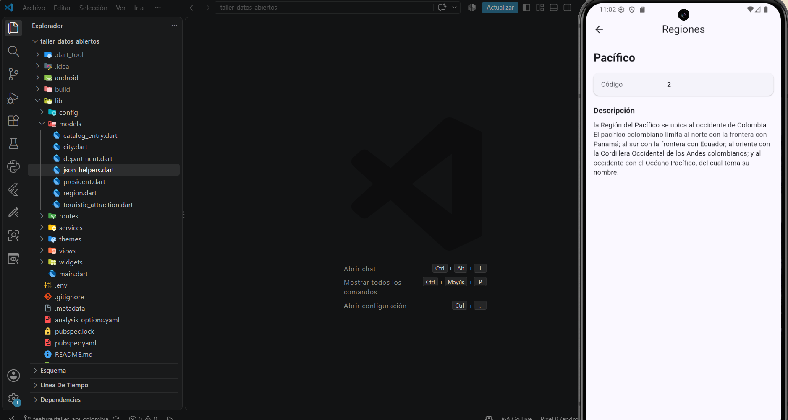
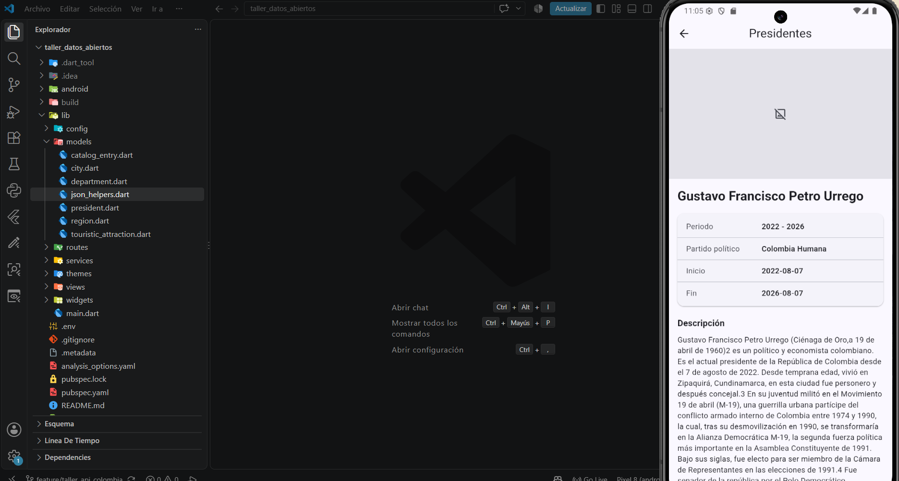
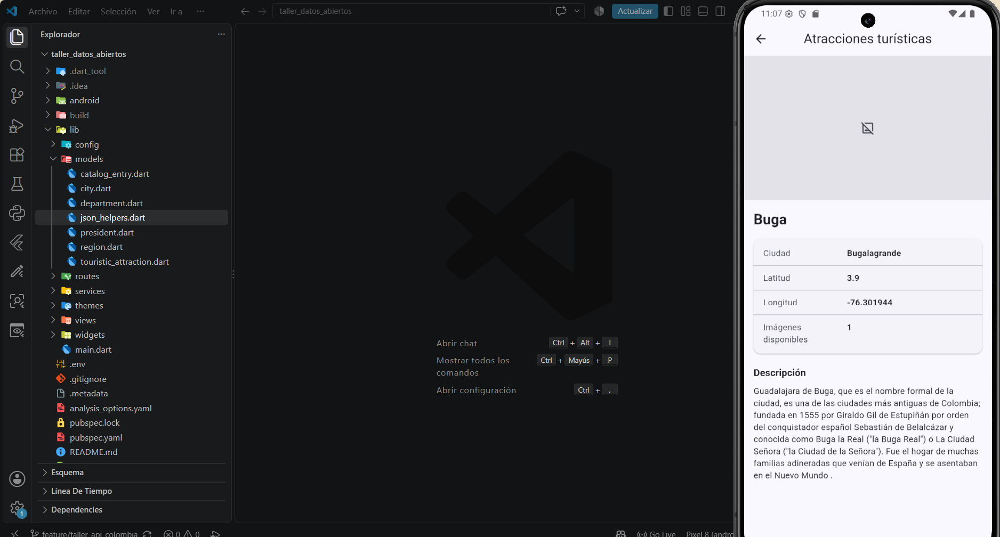
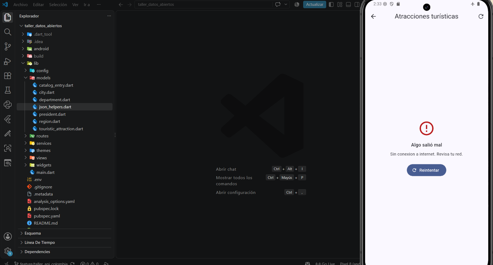

# Datos Abiertos de Colombia

Aplicación Flutter que consume la API pública [API Colombia](https://api-colombia.com) y muestra información de departamentos, regiones, presidentes y atracciones turísticas de Colombia.

Proyecto desarrollado para la asignatura **Electiva Profesional I** (Taller Flutter – Datos Abiertos de Colombia).

**Autor:** John Stiven Gonzalez Rivera · **Código:** 230232038

---

## Descripción de la API

- **Base URL:** `https://api-colombia.com/api/v1`
- **Autenticación:** no requiere.
- **Límite de uso:** 60 solicitudes por minuto por IP en algunos endpoints. Por eso la app guarda en memoria las respuestas ya consultadas (caché en memoria), para no repetir peticiones innecesarias durante la sesión.

### Endpoints utilizados

| Dataset | Endpoint | Descripción | Campos principales |
|---|---|---|---|
| Departamentos | `GET /Department` | Departamentos con capital, población, superficie y municipios | `name`, `capital`, `population`, `area`, `municipalities`, `description` |
| Regiones | `GET /Region` | Regiones naturales del país | `name`, `description`, `departments` |
| Presidentes | `GET /President` | Presidentes con periodo y partido político | `name`, `lastName`, `startPeriodDate`, `endPeriodDate`, `politicalParty`, `image`, `description` |
| Atracciones turísticas | `GET /TouristicAttraction` | Lugares turísticos con ciudad, ubicación e imágenes | `name`, `city`, `latitude`, `longitude`, `images`, `description` |

> Nota: `latitude` y `longitude` llegan como texto desde la API y se convierten a número con `json_helpers.dart`.

---

## Arquitectura

La aplicación está organizada por capas dentro de `lib/`:

```
lib/
├── config/      # Carga de variables de entorno (.env) mediante la clase Env
├── models/      # Modelos con fromJson / toJson (Department, Region, President, TouristicAttraction, City, CatalogEntry)
├── routes/      # Rutas de go_router (app_router.dart) y nombres de rutas (app_routes.dart)
├── services/    # Lógica HTTP: ApiClient (caché en memoria y manejo de errores) y ColombiaService (un método por endpoint)
├── themes/      # Tema global de la aplicación
├── views/       # Pantallas: Dashboard, Listado y Detalle (genéricas para los cuatro datasets)
├── widgets/     # Widgets reutilizables: estados (cargando, error), imagen remota y tarjeta
└── main.dart    # Punto de entrada: carga el .env y arranca go_router
```

### Separación de responsabilidades

- **Services:** son los únicos que hacen peticiones HTTP. `ApiClient` traduce los errores a `ApiException`, y `ColombiaService` es un singleton con un método por endpoint.
- **Models:** convierten el JSON en objetos Dart y viceversa.
- **Views:** solo muestran datos y reaccionan a los estados de carga, éxito y error.
- **Widgets:** piezas visuales reutilizables que no conocen la API.

### Catálogo de datasets

Las vistas Listado y Detalle son genéricas. Reciben el nombre del dataset por la ruta (`catalog_entry.dart` y `datasets.dart`) y eligen el servicio y el modelo que corresponde. Por eso el mismo código sirve para los cuatro endpoints.

---

## Rutas (go_router)

| Ruta | Nombre | Parámetros | Vista |
|---|---|---|---|
| `/` | `dashboard` | ninguno | Dashboard con las cuatro categorías |
| `/lista/:dataset` | `lista` | `dataset`: nombre del dataset (ej. `department`) | Listado con `ListView.builder` |
| `/lista/:dataset/:id` | `detalle` | `dataset`, `id`: identificador del registro | Detalle del registro |

---

## Capturas

### Dashboard


### Listados
| Departamentos | Regiones |
|---|---|
|  |  |

| Presidentes | Atracciones turísticas |
|---|---|
|  |  |

### Detalles
| Departamento (Antioquia) | Región (Pacífico) |
|---|---|
|  |  |

| Presidente (Gustavo Petro) | Atracción (Buga) |
|---|---|
|  |  |

### Estados
| Error (sin conexión) |
|---|
|  |

---

## Ejemplo de respuesta JSON

Endpoint base: [https://api-colombia.com/api/v1/Region](https://api-colombia.com/api/v1/Region)

Respuesta real del endpoint `Region` (se muestra un solo elemento de la lista `value`):

```json
{
    "value": [
        {
            "id": 1,
            "name": "Caribe",
            "description": "La región caribe es una de las regiones más importantes del territorio colombiano...",
            "departments": null
        }
    ],
    "Count": 6
}
```

---

## Estados de la interfaz

- **Cargando:** se muestra un indicador de progreso mientras llega la respuesta. Como la API responde rápido, este estado dura muy poco.
- **Éxito:** se muestra la lista o el detalle con los datos.
- **Error:** si no hay conexión o la API falla, se muestra un mensaje de error con opción de reintentar.

---

## Limitaciones conocidas

- **Imágenes de presidentes:** las fotos vienen de Wikimedia. En algunas pruebas el emulador mostró el icono de respaldo en lugar de la imagen, por tiempos de respuesta o por la URL. El icono de respaldo evita que la app falle.
- **Periodo de los presidentes:** `periodLabel` muestra "actualidad" cuando `endPeriodDate` es nulo. Esto es correcto para el presidente en ejercicio, pero no sería exacto para un registro histórico que no tenga fecha de fin.
- **Inconsistencia en los datos de la fuente:** el registro de atracción de Buga indica "Bugalagrande" como ciudad, mientras que la descripción se refiere a Guadalajara de Buga. Es un dato de la API; la aplicación lo muestra tal como lo entrega.

---

## Cómo ejecutar

```bash
git clone https://github.com/johngonzalez02/taller_datos_abiertos.git
cd taller_datos_abiertos
flutter pub get
flutter run
```

Requiere un archivo `.env` en la raíz con:

```
API_BASE_URL=https://api-colombia.com/api/v1
```

---

## Video

[Enlace al video del funcionamiento y del desarrollo](https://drive.google.com/drive/folders/19CM8yt5z4P2PbHi0L35tZVzw-o6P6S8r?usp=drive_link)